# BEC Attack Simulation

## Overview

This lab demonstrates a Business Email Compromise (BEC)-related credential phishing
scenario using Kali Linux as the attacker system and Windows 11 as the victim endpoint.

The simulation is delivered in phases. Phase 1 (browser-based access) is complete.
Phase 2 (infrastructure realism) is complete. Phase 3 (email delivery) is in progress.

## Lab Environment

- Attacker: Kali Linux VM
- Victim: Windows 11 VM
- Network: VMware host-only (192.168.23.0/24)
- Web Server: Apache2
- Server-Side Processing: PHP
- DNS: dnsmasq (local resolver)
- Monitoring Platform: Wazuh (integrated)

All activity is conducted within a controlled virtual lab using test credentials.

## Attack Chain

### Phase 1 - Browser-Based Simulation (Complete)

1. Reconnaissance: Prepared the simulated target environment.
2. Lure Development: Created a Microsoft 365-themed login page.
3. Infrastructure Setup: Configured Apache2 and a PHP handler to receive submissions.
4. Delivery: Accessed the phishing page directly from the Windows VM browser.
5. Victim Interaction: Entered test credentials into the simulated login form.
6. Credential Capture: Submitted credentials through HTTP POST to login.php.
7. Redirect: Redirected the browser after submission.

#### Phase 1 Evidence

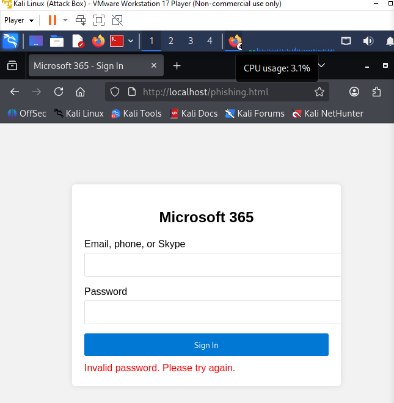

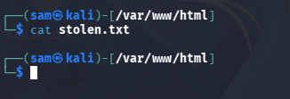

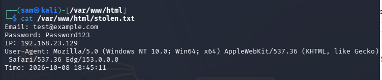

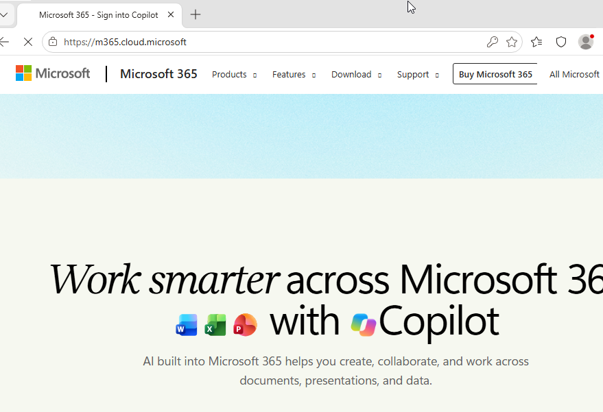

### Phase 2 - Infrastructure Realism (Complete)

8. DNS Infrastructure: Deployed dnsmasq to serve a lookalike domain, replacing the
   raw IP address with a plausible hostname.
9. Page Rebuild: Rebuilt the login page as a Microsoft Entra ID SSO screen with a
   two-stage email-then-password flow.
10. Landing Page: Added a supplier billing portal and invoice.

### Phase 3 - Email Delivery (In Progress)

11. Mail Infrastructure: Deploy a local mail server for realistic delivery.
12. Message Construction: Build a business-realistic BEC lure.
13. Delivery: Send the message to the victim mailbox.
14. Authentication Analysis: Examine SPF, DKIM and DMARC outcomes.
15. Detection: Observe what Sysmon, Suricata and Wazuh record.

## Phishing Infrastructure

### DNS Layer

A local dnsmasq resolver provides the lookalike domain northwlndtraders.com, which
differs from the legitimate northwindtraders.com by a single character.

Full detail: [DNS Setup](../environment/DNS-Setup.md)

### Phishing Page

- File Location: /var/www/html/invoice/NW-4471/index.html
- Source Location: assets/web/phishing.html
- Form Fields: Email and password
- Submission Method: HTTP POST
- Form Handler: login.php

The page mimics a Microsoft Entra ID SSO prompt, framed as "Sign in to continue to
Northwind Traders." This framing explains why a supplier's billing portal presents a
Microsoft login, and mirrors the login_hint behaviour of real SSO links by prefilling
the victim address.

The flow is two-stage - email, then password - matching genuine Microsoft
authentication behaviour.

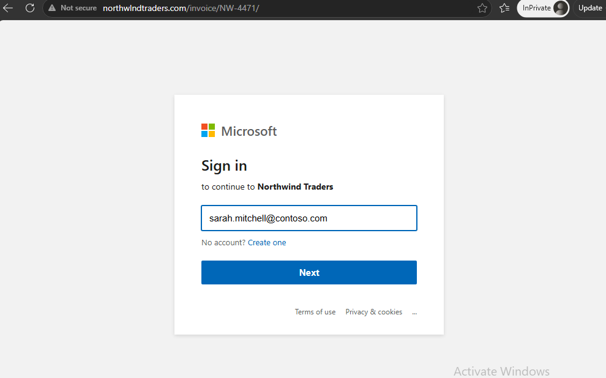

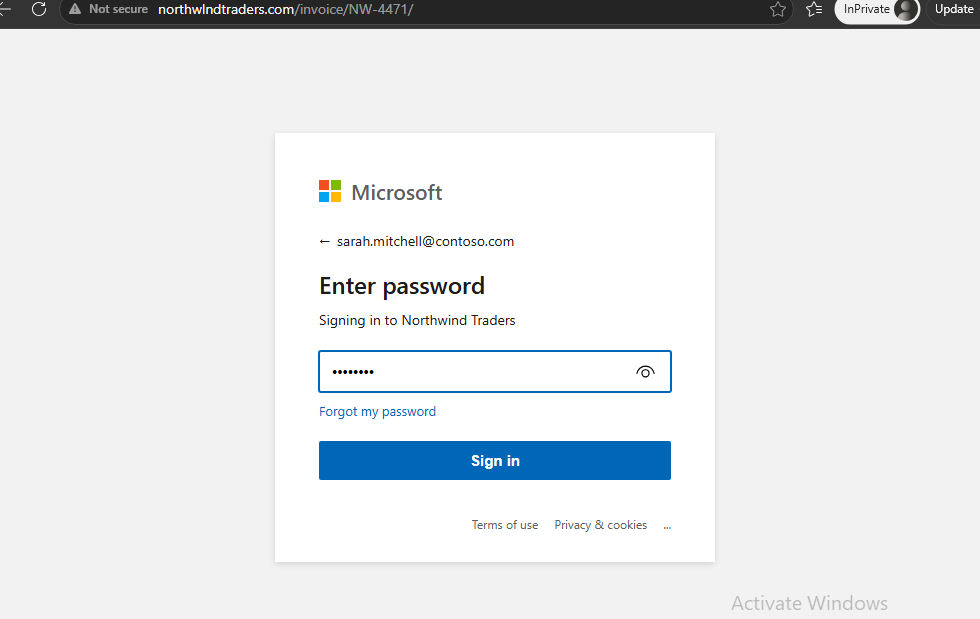

### Form Submission

Both fields reside in a single form, so the server receives one POST containing both
values despite the two-screen presentation.

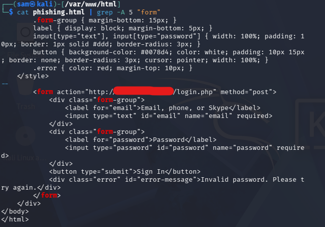

### Credential Capture

The PHP handler records the submitted data plus investigation metadata:

- Submitted email address
- Submitted password
- Source IP address
- Browser user-agent
- Timestamp

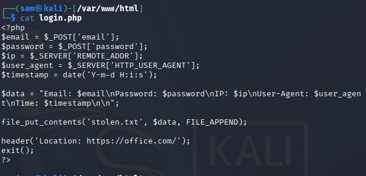

### Credential Storage

Captured data is appended to /var/www/html/stolen_creds.txt.

- Format: One block per submission, including timestamp, source IP and user-agent
- Purpose: Demonstrate server-side capture and provide an incident timeline

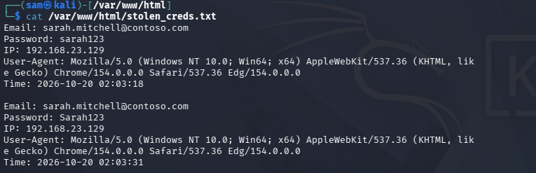

### Landing Page

After submission, the handler issues an HTTP 302 redirect to a simulated supplier
billing portal. This is more realistic than returning the user to the login screen -
real SSO redirects onward to the target application.

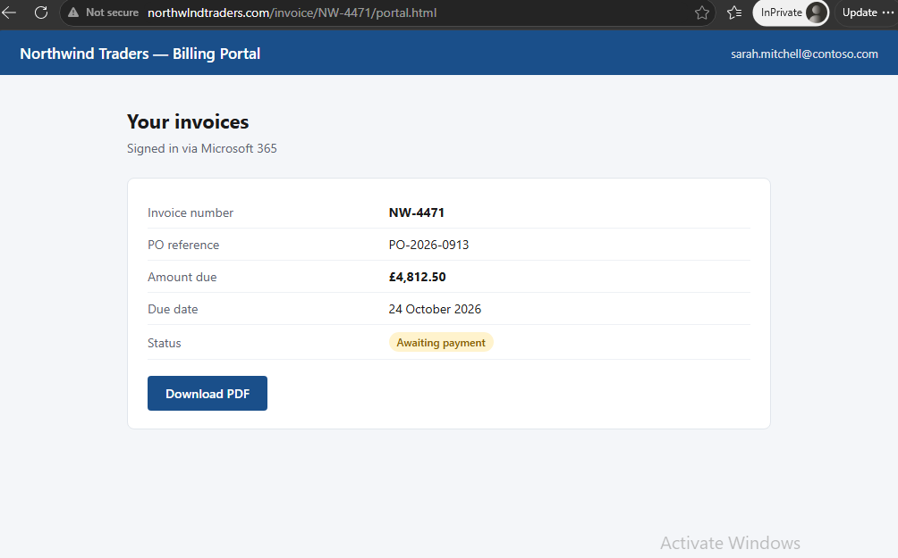

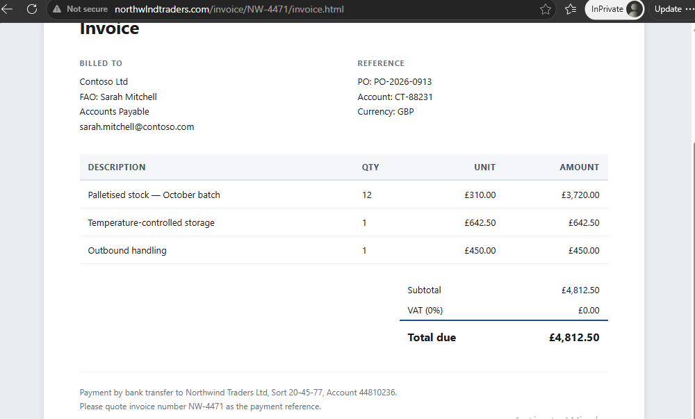

## Attack Execution

### Step 1: Access the Phishing Page

Reached via the lookalike domain rather than a raw IP:
http://northwlndtraders.com/invoice/NW-4471

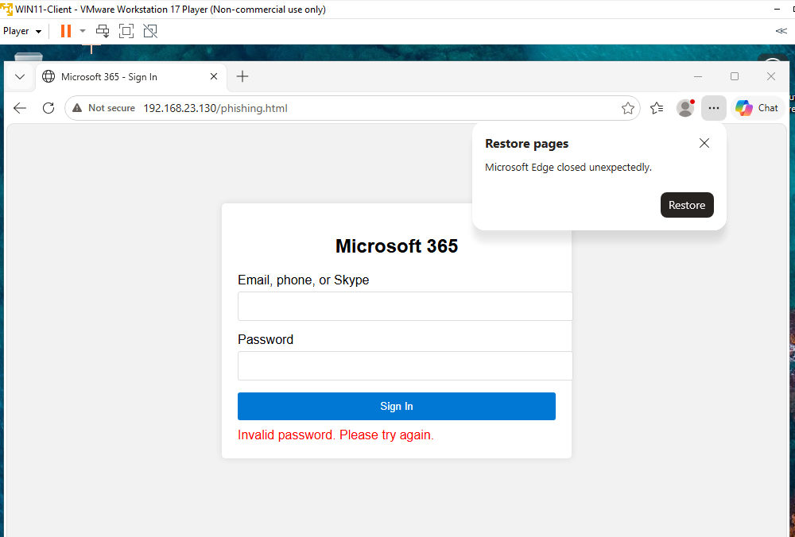

### Step 2: Submit Test Credentials

Test credentials are entered into the simulated SSO form and submitted via HTTP POST.

### Step 3: Verify Credential Capture

Capture is verified on the Kali server. Recorded metadata confirms the submission
reached the server and was processed.

### Step 4: Redirect

The handler returns an HTTP 302. The browser follows it automatically to the billing
portal.

## Email Delivery

Email-based delivery is the current phase of work.

A locally hosted mail server is used rather than a public relay, so DNS records for
SPF, DKIM and DMARC remain fully under our control.

Two delivery variants are planned using identical message bodies:

| Variant | Sending domain | Expected authentication outcome |
|---|---|---|
| A | northwindtraders.com (spoofed, unowned) | SPF fail, DKIM fail, DMARC fail |
| B | northwlndtraders.com (attacker-owned) | SPF pass, DKIM pass, DMARC pass |

## Detection Opportunities

### Network Activity

- HTTP connections from Windows 11 to the Kali web server
- HTTP POST requests to the PHP handler
- DNS queries to the local resolver
- SMTP traffic between mail hosts

### Endpoint Activity

- Browser and mail client process activity
- Network connections initiated by those processes

### Server-Side Evidence

- Apache2 access logs
- Requests to login.php
- Timestamped submissions with source metadata
- Mail server logs and full message headers

Validation is performed against the existing monitoring configuration first, so that a
genuine baseline is established before any rules are written.

## Mitigation Strategies

### Security Awareness

Educate users to recognise suspicious login pages and unfamiliar domain names -
particularly single-character variations.

### Email Security

Deploy SPF, DKIM and DMARC with a policy of quarantine or reject. Note that DMARC
only protects a domain if the legitimate owner publishes it; a lookalike domain under
attacker control will pass all checks.

### Multifactor Authentication

Implement phishing-resistant MFA to reduce the impact of credential theft.

### Endpoint and Network Monitoring

Collect browser and mail client telemetry via Sysmon and Wazuh, and monitor HTTP, DNS
and SMTP traffic for anomalous destinations.

## Test Results

| Test | Result |
|---|---|
| Apache2 web server hosting | Successful |
| Windows VM access to phishing page | Successful |
| HTML form submission | Successful |
| PHP processing of test credentials | Successful |
| Test credential storage with metadata | Successful |
| Redirect to landing page | Successful |
| Local DNS resolution of lookalike domain | Successful |
| Two-stage SSO page rendering | Successful |
| Email-based delivery | In progress |
| SPF / DKIM / DMARC analysis | Pending |
| Wazuh / Sysmon / Suricata detection | Pending |
| Post-exploitation | Not performed |

## Conclusion

The browser-based credential phishing simulation is complete, and the supporting
infrastructure has been upgraded to a level of realism that mirrors genuine phishing
operations: a lookalike domain served by a controlled resolver, an Entra ID SSO clone,
and a believable post-authentication landing page.

This establishes the baseline for the email delivery phase.

## Next Steps

1. Deploy a local mail server (MTA and IMAP) on the isolated network.
2. Publish SPF, DKIM and DMARC records for the lab domains.
3. Construct and deliver the BEC lure in both spoofed and lookalike variants.
4. Analyse message headers and authentication results.
5. Repeat the simulation against the monitoring stack to establish a detection baseline.
6. Develop detection rules for observed gaps.
7. Produce a full SOC incident report with timeline, IOCs and ATT&CK mapping.
