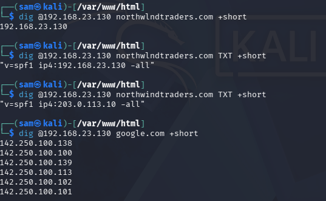
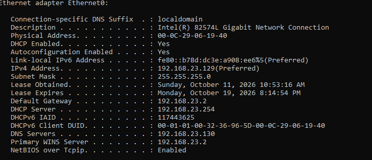
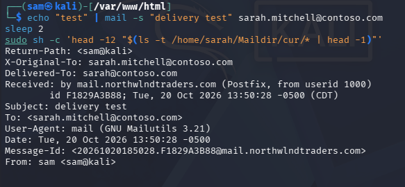
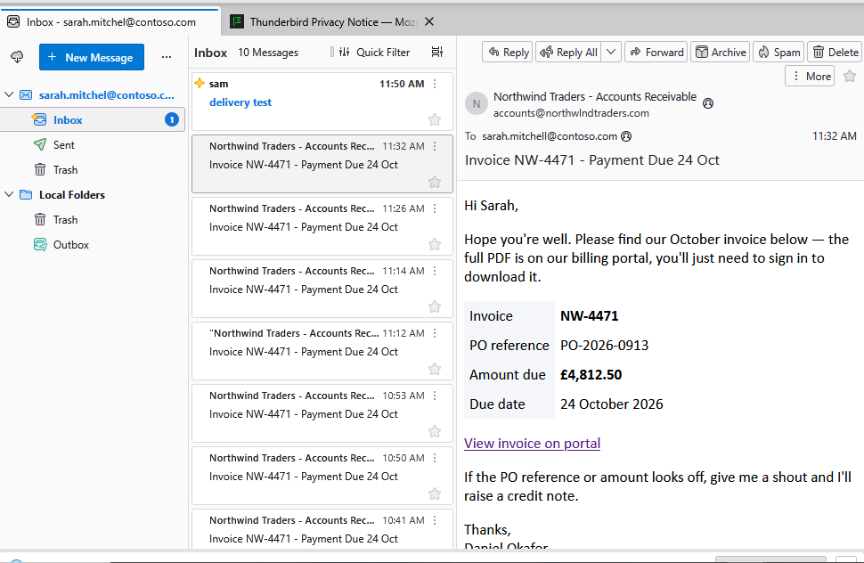
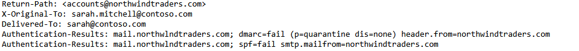
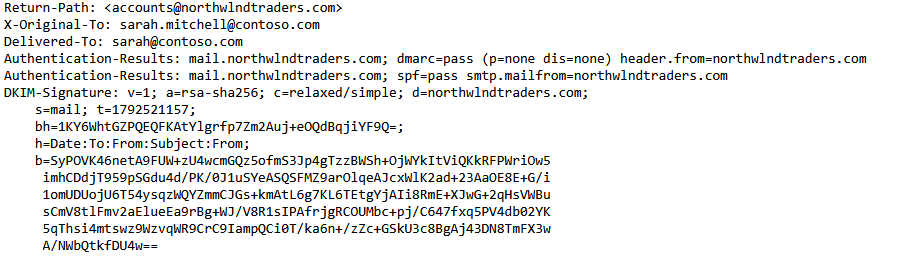
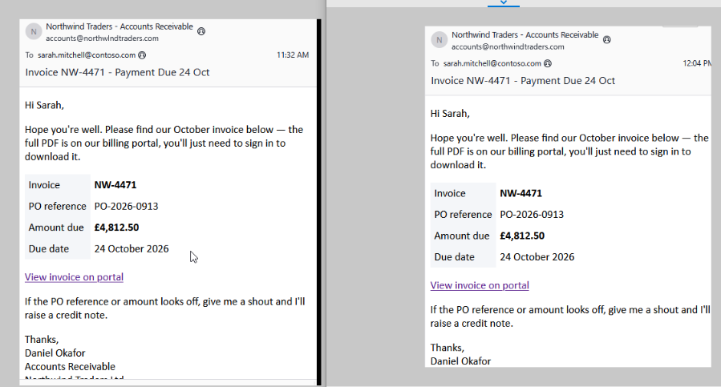

# BEC Attack Simulation

## Overview

This lab demonstrates a Business Email Compromise (BEC)-related credential phishing
scenario using Kali Linux as the attacker system and Windows 11 as the victim endpoint.

The simulation was delivered in three phases, all complete:

- **Phase 1** - browser-based credential capture
- **Phase 2** - infrastructure realism: lookalike domain, SSO clone, landing page
- **Phase 3** - email delivery and authentication analysis

## Lab Environment

- Attacker: Kali Linux VM
- Victim: Windows 11 VM
- Network: VMware host-only (192.168.23.0/24)
- Web Server: Apache2
- Server-Side Processing: PHP
- DNS: dnsmasq (local resolver)
- Mail Server: Postfix
- IMAP Server: Dovecot
- Authentication: OpenDKIM, OpenDMARC
- Victim Mail Client: Thunderbird
- Monitoring Platform: Wazuh (integrated)

All activity is conducted within a controlled virtual lab using test credentials.

## Attack Chain

### Phase 1 - Browser-Based Simulation (Complete)

1. Reconnaissance and lure development
2. Infrastructure setup: Apache2 and a PHP handler
3. Delivery by direct browser access
4. Victim interaction and credential submission
5. Capture and redirect

### Phase 2 - Infrastructure Realism (Complete)

6. DNS infrastructure serving a lookalike domain
7. Page rebuild as an Entra ID SSO clone
8. Capture upgraded with timestamp, IP and User-Agent
9. Post-authentication landing page added

### Phase 3 - Email Delivery and Authentication (Complete)

10. Mail server deployment
11. Authentication controls configured
12. BEC lure constructed and delivered in two variants
13. SPF, DKIM and DMARC outcomes analysed

---

## Phase 1 - Browser-Based Simulation

Phase 1 proved the concept using the simplest possible setup: a static page served by
raw IP, with a PHP handler capturing submissions.

The original lure was a single-page Microsoft 365 login clone.

*The initial lure. Single page, single stage, served by IP address.*

The form posted to a PHP handler on the same host.

*Form action pointing at login.php.*

The handler recorded the submitted credentials along with request metadata.

*The original capture script.*

Submissions were appended to a flat file, which was empty before the test.

*Capture file prior to the first submission.*

The page was then loaded from the Windows victim and the form submitted.

*Victim browsing to the page by raw IP.*

The capture file confirmed the submission reached the server.

*Credentials recorded. Note the absence of timestamp and source IP.*

The browser was then redirected onward.

*Post-submission redirect.*

---

## Phase 2 - Infrastructure Realism

Phase 1 worked, but a raw IP address and a single-page form are both weak points. Phase 2
addressed each.

| Area | Phase 1 | Phase 2 |
|---|---|---|
| Delivery address | Raw IP | Lookalike domain northwlndtraders.com |
| DNS | Not used | dnsmasq serving A, MX and TXT records |
| Login page | Single-page clone | Two-stage Entra ID SSO clone |
| Capture log | Credentials only | Credentials plus timestamp, IP, User-Agent |
| Post-authentication | Redirect to a public page | Simulated billing portal with invoice |
| Authentication groundwork | None | SPF and DMARC TXT records published |

### DNS Infrastructure

The lookalike domain differs from the legitimate northwindtraders.com by a single
character. dnsmasq was configured to serve it, and the Windows endpoint pointed at the
resolver.

*Resolver configuration. The address, MX and TXT records are all defined here.*

*Resolution verified from the attacker host before any client change.*

*Victim endpoint pointed at the local resolver.*

Full detail: [DNS Setup](../environment/DNS-Setup.md)

### Phishing Page Rebuild

The page was rebuilt as an Entra ID SSO prompt, framed as "Sign in to continue to
Northwind Traders". This explains why a supplier's billing portal presents a Microsoft
login.

The flow is two-stage, matching genuine Microsoft behaviour.

*The rebuilt lure. Note the domain in the address bar.*

*Second stage. The address is echoed back, as a real SSO flow does.*

### Capture Upgrade

The handler was extended to record a timestamp, source IP and User-Agent alongside the
credentials. Credentials alone prove capture; the metadata provides chronology.

*Capture with full metadata. Compare against the Phase 1 capture.*

### Landing Page

Rather than returning the user to the login screen, the handler now redirects to a
simulated supplier billing portal showing the referenced invoice.

*Landing page after authentication.*

*The invoice behind the Download PDF button.*

---

## Phase 3 - Email Delivery and Authentication

The final phase delivered the lure by email rather than by pasting a URL, and built the
authentication controls needed to inspect it.

### Mail Server

A local server was used rather than a public relay, so the SPF, DKIM and DMARC records
stay fully under our control. Postfix handles sending and receiving, Dovecot serves the
victim mailbox, and Thunderbird connects over IMAP.

*Postfix configuration. mydestination includes both the server and victim domains.*

*Local delivery verified before sending anything external.*

*Victim mailbox opened from the Windows endpoint.*

Full detail: [Mail Server Setup](../environment/Mail-Server-Setup.md)

### Authentication Controls

SPF and DMARC were published as TXT records. A 2048-bit DKIM key was generated and its
public half published in DNS. OpenDKIM and OpenDMARC run as Postfix milters, writing
verdicts to Authentication-Results headers.

*Verdicts produced on the receiving side.*

*Signature added by OpenDKIM for the owned domain.*

### Delivery Variants

The lure is a supplier invoice notification - deliberately mundane, with a PO reference
and a due date. Both variants carry an identical body and link. Only the sending domain
differs, by one character.

| | Variant A | Variant B |
|---|---|---|
| Sending domain | northwindtraders.com (not owned) | northwlndtraders.com (owned) |
| SPF | fail | pass |
| DKIM | none | pass |
| DMARC | fail (p=quarantine) | pass (p=none) |

Both use the identical display name, so they are indistinguishable in a client's list
view until opened.

*Both variants side by side in the victim inbox.*

Full analysis: [SPF, DKIM and DMARC Analysis](../attack-analysis/SPF-DKIM-DMARC-Analysis.md)

---

## End-to-End Attack Execution

With all phases complete, the full chain runs as follows.

1. The phishing email is delivered to the victim mailbox.
2. The victim opens it and clicks the link to the lookalike domain.
3. The SSO clone captures the credentials and records metadata.
4. The browser is redirected to a believable billing portal.
5. The invoice loads on request.

## Detection Opportunities

### Network Activity

- HTTP connections from Windows 11 to the Kali web server
- HTTP POST requests to the PHP handler
- DNS queries to the local resolver
- SMTP traffic between mail hosts

### Endpoint Activity

- Browser and mail client process activity
- Network connections initiated by those processes

### Server-Side Evidence

- Apache2 access logs
- Requests to login.php
- Timestamped submissions with source metadata
- Mail server logs and full message headers
- Authentication-Results verdicts

Validation is performed against the existing monitoring configuration first, so a genuine
baseline is established before any rules are written.

## Mitigation Strategies

### Security Awareness

Educate users to recognise suspicious login pages and unfamiliar domain names,
particularly single-character variations.

### Email Security

Deploy SPF, DKIM and DMARC with a policy of quarantine or reject. Note that DMARC only
protects a domain if the legitimate owner publishes it; a lookalike under attacker control
passes every check.

### Multifactor Authentication

Implement phishing-resistant MFA to reduce the impact of credential theft.

### Endpoint and Network Monitoring

Collect browser and mail client telemetry via Sysmon and Wazuh, and monitor HTTP, DNS and
SMTP traffic for anomalous destinations.

## Test Results

| Test | Result |
|---|---|
| Apache2 web server hosting | Successful |
| Windows VM access to phishing page | Successful |
| HTML form submission | Successful |
| PHP processing of test credentials | Successful |
| Test credential storage with metadata | Successful |
| Redirect to landing page | Successful |
| Local DNS resolution of lookalike domain | Successful |
| Two-stage SSO page rendering | Successful |
| Mail server send and receive | Successful |
| IMAP mailbox access from victim client | Successful |
| SPF and DMARC verification | Successful |
| DKIM signing and signature validation | Successful |
| Phishing email delivery | Successful |
| Wazuh / Sysmon / Suricata detection | Pending |
| Post-exploitation | Not performed |

## Conclusion

The simulation covers the complete phishing chain: a realistic business email from a
lookalike domain, an SSO clone capturing credentials with metadata, and a believable
landing page. SPF, DKIM and DMARC were analysed against both a spoofed and an owned
sending domain.

The central finding is that authentication confirms a domain is authorised, not that it
is genuine. The lookalike variant passed every control while remaining a one-character
typo.

## Next Steps

1. Repeat the simulation against the monitoring stack to establish a detection baseline.
2. Determine which stages are observable and which are gaps.
3. Develop detection rules for the gaps.
4. Produce a full SOC incident report with timeline, IOCs and ATT&CK mapping.
