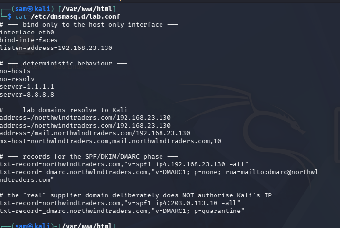

# DNS Infrastructure (dnsmasq)

## Overview

This document describes the local DNS infrastructure built to support the phishing simulation. It gives the campaign a realistic domain name instead of a raw IP address, and provides the record types required for the later email authentication work.

The resolver runs on the Kali attacker VM and serves only the isolated lab network.

The guide is written to be followed from a standing start. Every command is explained, and every step says what you should see before you move on.

## Why a Local DNS Server Is Required

A DNS server is the phonebook of a network. When you type a name like `northwlndtraders.com` into a browser, something has to translate that name into an IP address the computer can actually connect to. Normally that "something" is a public resolver owned by an ISP or by Cloudflare.

The lookalike domain used in this campaign is not registered on the public internet, so no public resolver knows about it. Public resolvers return NXDOMAIN, which means "this name does not exist". Two problems follow:

1. The phishing link `http://northwlndtraders.com/invoice/NW-4471` would not resolve.
2. SPF, DKIM and DMARC are published as DNS **TXT records**. Without a resolver under our control there is nothing to query, and email authentication cannot be demonstrated at all.

A local resolver solves both. It is also the mechanism real phishing infrastructure uses — the only difference is that a real attacker registers the domain with a registrar rather than hand-writing the entry.

## What You Will Build

A small DNS server on the Kali VM that:

- answers for the lab's fake domains with the Kali VM's own IP address
- forwards everything else to the real internet
- publishes the SPF, DMARC and DKIM records the email phase depends on

The Windows VM is then told to use this server instead of the normal one.

## Domain Design

| Domain | Role |
|---|---|
| `northwlndtraders.com` | Attacker-owned lookalike. Differs from the legitimate domain by a single character (`i` → `l`). |
| `northwindtraders.com` | Simulated legitimate supplier domain. Deliberately not authorised for Kali's IP, so spoofed mail fails SPF. |
| `contoso.com` | Victim domain. Resolves to the lab server so mail and the web lure stay on-network. |
| `mail.northwlndtraders.com` | MX target for the lab mail server. |

The single-character difference is intentional. It demonstrates that a victim cannot visually distinguish the two domains, and that header analysis is the only reliable way to tell them apart.

## Architecture

| Component | Host | Function |
|---|---|---|
| dnsmasq | Kali Linux | Local authoritative answers + upstream forwarding |
| Resolver | Windows 11 | Configured to query Kali for all lookups |



## How to Read the Commands

- **Kali** means the Kali Linux virtual machine. **Windows** means the Windows 11 virtual machine. Run each command on the machine named in the heading.
- On Kali, open a terminal with `Ctrl + Alt + T`, or via the application menu.
- A line starting with `sudo` runs the command as administrator. The first time you use it in a session, Kali asks for your password. **The password does not appear on screen as you type it** — that is normal, not a broken keyboard. Type it and press Enter.
- Anything in angle brackets like `<your-connection-name>` is a placeholder. Replace it with your real value, and do not type the brackets.
- Where a command produces output, the guide says what you should see. Compare before continuing.

## Build Steps

### Step 1 — Check the environment first

Before changing anything, confirm three things: the network card name, that nothing else is already using port 53 (the port DNS runs on), and that the web server is running.

```bash
ip -4 a
```

This lists your network interfaces and their IPv4 addresses. You are looking for the host-only interface — in this lab it is `eth0` with the address `192.168.23.130`. Write down the exact interface name; you will need it in step 4.

```bash
sudo ss -ulpn | grep ':53'
```

This asks "is anything already listening on UDP port 53?". **No output at all is the result you want** — it means the port is free. If something is listed, another DNS service is already running and the two will fight over the port.

```bash
systemctl is-active apache2
```

This prints the state of the web server. It must print `active`. If it prints `inactive`, start it and enable it so it survives a reboot:

```bash
sudo systemctl enable --now apache2
```

### Step 2 — Install dnsmasq

```bash
sudo apt update
```

Refreshes the list of available software packages. It is worth doing first so you install a current version.

```bash
sudo apt install -y dnsmasq dnsutils
```

Installs two packages:

- **dnsmasq** — the DNS server itself
- **dnsutils** — a toolkit containing `dig`, the command used later to test DNS lookups

The `-y` answers "yes" to the confirmation prompt automatically.

On Kali, dnsmasq is installed as a **static unit that is not started automatically**. Installing it does not start it. That is expected, and step 5 starts it deliberately.

### Step 3 — Confirm dnsmasq will read your config file

dnsmasq has one main config file, `/etc/dnsmasq.conf`, which is long. Rather than editing it, the convention is to drop small extra files into `/etc/dnsmasq.d/`. The main file includes that folder — but only if the include line is switched on.

```bash
grep -n "conf-dir" /etc/dnsmasq.conf
```

This searches the main config for the include line and shows it with its line number. You want to see:

```
conf-dir=/etc/dnsmasq.d/,*.conf
```

The `#` at the start of a line means "comment", i.e. switched off. If the only lines returned all begin with `#`, add an active include line:

```bash
echo 'conf-dir=/etc/dnsmasq.d/,*.conf' | sudo tee -a /etc/dnsmasq.conf
```

`echo` prints the text, `tee -a` appends it to the file as administrator, and `sudo` is needed because the file is owned by root. Without this, your config file in step 4 would sit there being completely ignored.

### Step 4 — Create the configuration file

```bash
sudo nano /etc/dnsmasq.d/lab.conf
```

`nano` is a simple text editor. It opens the file, creating it if it does not exist. Type or paste the following, then save.

```conf
# --- bind to the host-only interface and loopback only ---
interface=eth0
interface=lo
bind-interfaces
listen-address=192.168.23.130
listen-address=127.0.0.1

# --- deterministic behaviour ---
no-hosts
no-resolv
server=1.1.1.1
server=8.8.8.8

# --- lab domains resolve to Kali ---
address=/northwlndtraders.com/192.168.23.130
address=/northwindtraders.com/192.168.23.130
address=/mail.northwlndtraders.com/192.168.23.130
address=/contoso.com/192.168.23.130
address=/mail.contoso.com/192.168.23.130

# --- MX records ---
mx-host=northwlndtraders.com,mail.northwlndtraders.com,10
mx-host=contoso.com,mail.contoso.com,10

# --- SPF and DMARC records ---
txt-record=northwlndtraders.com,"v=spf1 ip4:192.168.23.130 -all"
txt-record=_dmarc.northwlndtraders.com,"v=DMARC1; p=none; rua=mailto:dmarc@northwlndtraders.com"

# the "real" supplier domain deliberately does NOT authorise Kali's IP
txt-record=northwindtraders.com,"v=spf1 ip4:203.0.113.10 -all"
txt-record=_dmarc.northwindtraders.com,"v=DMARC1; p=quarantine"

# --- DKIM public key, added during the mail phase ---
# value taken verbatim from /etc/opendkim/keys/northwlndtraders.com/mail.txt
txt-record=mail._domainkey.northwlndtraders.com,"v=DKIM1; h=sha256; k=rsa; p=<BASE64_PUBLIC_KEY>"
```

**To save in nano:** press `Ctrl + O`, then `Enter` to confirm the filename, then `Ctrl + X` to exit. The shortcuts are also listed along the bottom of the screen.

If your interface is not called `eth0`, or your Kali IP is not `192.168.23.130`, change every occurrence to match what step 1 showed you.

#### What each line does

| Line | What it does |
|---|---|
| `interface=eth0` | Only answer queries arriving on the lab network card. |
| `interface=lo` | Also answer queries from Kali itself, over the loopback interface. |
| `bind-interfaces` | Only listen on the addresses listed below, instead of every address on the machine. Avoids clashing with other services. |
| `listen-address=...` | The exact addresses to listen on. One is the lab IP, one is loopback (`127.0.0.1`). |
| `no-hosts` | Ignore the machine's `/etc/hosts` file. Keeps answers predictable. |
| `no-resolv` | Ignore the machine's `/etc/resolv.conf` when deciding where to forward unknown names. |
| `server=1.1.1.1` | Forward anything we do not know about to Cloudflare. |
| `server=8.8.8.8` | A second upstream, used if the first is unreachable. |
| `address=/domain/IP` | Answer every query for that domain — and all of its subdomains — with this IP. This is the core of the fake DNS. |
| `mx-host=domain,target,10` | An MX record: which host receives email for the domain. The `10` is the priority. |
| `txt-record=...` | A TXT record. Free-form text attached to a name. SPF, DMARC and DKIM are all TXT records. |

The double quotes around the TXT values are part of the syntax. dnsmasq uses them to know where the value starts and ends, so do not remove them.

### Step 5 — Start the resolver

```bash
sudo systemctl enable --now dnsmasq
```

`enable` makes dnsmasq start automatically at boot. `--now` also starts it immediately, so you do not have to reboot.

```bash
sudo systemctl status dnsmasq --no-pager
```

Shows whether it is running. You want a line reading `Active: active (running)`. Press `q` if it drops you into a pager.

If it failed, read the last lines of the service log:

```bash
journalctl -u dnsmasq -n 50 --no-pager
```

The `-n 50` shows the last 50 lines. In practice the cause is almost always a port 53 clash, meaning something else already holds the DNS port — go back and re-check step 1.

### Step 6 — Test resolution from Kali

Now prove it actually answers. `dig` sends a DNS query and prints the reply. The `@192.168.23.130` part means "ask this specific server", and `+short` trims the output down to just the answer.

```bash
dig @192.168.23.130 northwlndtraders.com +short
```

Expected: `192.168.23.130`

```bash
dig @192.168.23.130 northwlndtraders.com TXT +short
```

Expected: `"v=spf1 ip4:192.168.23.130 -all"`

```bash
dig @192.168.23.130 northwindtraders.com TXT +short
```

Expected: `"v=spf1 ip4:203.0.113.10 -all"` — note the different IP. This domain deliberately does not authorise our server, which is what makes the spoofed email fail later.

```bash
dig @192.168.23.130 google.com +short
```

Expected: a real public IP address. This proves the forwarding in the `server=` lines works. If this one returns nothing while the others work, your upstream forwarding is broken and the lab will have no internet access.

### Step 7 — Point the Windows VM at Kali for DNS

On the **Windows** VM. Open an elevated Command Prompt: press the Windows key, type `cmd`, right-click **Command Prompt**, and choose **Run as administrator**.

```cmd
netsh interface ipv4 show interfaces
```

Lists the network interfaces with an index number and a name. Find the one that is connected — typically `Ethernet0` — and note the exact name.

```cmd
netsh interface ipv4 set dnsservers name="Ethernet0" static 192.168.23.130 primary
```

Tells Windows to use the Kali VM as its only DNS server. Replace `Ethernet0` with the name you just found.

```cmd
ipconfig /flushdns
```

Clears Windows' DNS cache. Windows remembers "that name does not exist" for a while, so without this the first lookups can still fail even though everything is configured correctly.

Now confirm from the Windows side:

```cmd
nslookup northwlndtraders.com
```

Expected: `Address: 192.168.23.130`

```cmd
nslookup google.com
```

Expected: a real public IP, proving forwarding still works for the Windows VM too.

**To undo this later**, if you want Windows back on automatic DNS:

```cmd
netsh interface ipv4 set dnsservers name="Ethernet0" dhcp
```

### Step 8 — Make the resolver answer on loopback

This was added once the email phase began. Postfix, the mail server, looks up SPF and DKIM records through Kali's own resolver. If dnsmasq only listens on the lab network card, Postfix cannot reach it and every email authentication check fails for the wrong reason.

```bash
echo "listen-address=127.0.0.1" | sudo tee -a /etc/dnsmasq.d/lab.conf
```

Appends one more listen address to the config file. `127.0.0.1` is "this machine", known as loopback.

```bash
sudo systemctl restart dnsmasq
```

`restart` is needed because dnsmasq only reads its config at startup. Editing the file alone changes nothing.

```bash
dig @127.0.0.1 northwlndtraders.com +short
```

Expected: `192.168.23.130`. Querying loopback directly proves the new listener works.

### Step 9 — Point Kali's own resolver at dnsmasq

Kali still has its own resolver settings, pointing at the VMware gateway, which knows nothing about the lab domains. This step sends Kali's own lookups to dnsmasq instead.

```bash
nmcli -t -f NAME,DEVICE con show --active
```

Lists active network connections and the device each uses. The output looks like `Wired connection 1:eth0`. Note the name before the colon.

Kali's `/etc/resolv.conf` is managed by NetworkManager, so editing it by hand gets overwritten. The change has to be made through `nmcli`. Substitute your connection name:

```bash
sudo nmcli con mod "Wired connection 1" ipv4.dns "127.0.0.1"
sudo nmcli con mod "Wired connection 1" ipv4.ignore-auto-dns yes
sudo nmcli con up "Wired connection 1"
```

The first line sets the DNS server. The second stops DHCP from overwriting it with the gateway's address. The third applies the change — expect the connection to blip for a second.

Confirm it took:

```bash
cat /etc/resolv.conf
```

Expected: a line reading `nameserver 127.0.0.1`. If it still shows `192.168.23.2`, the change did not apply — re-run the three `nmcli` commands.

```bash
dig northwlndtraders.com +short
dig google.com +short
```

Both must return an address. The first proves Kali can now resolve the lab domains; the second proves it still has internet access, because dnsmasq forwards to the upstream servers.

## Troubleshooting

| Symptom | Cause | Fix |
|---|---|---|
| dnsmasq will not start | Something else holds port 53 | Re-run `sudo ss -ulpn \| grep ':53'` and stop the other service |
| `dig` returns nothing for the lab domains | The config file is not being read | Re-check step 3 — the include line must be active |
| `dig` works for lab domains but not `google.com` | Upstream forwarding broken | Check the `server=` lines are present and that Kali has internet |
| Windows cannot resolve anything at all | Kali is down, or dnsmasq stopped | Windows now depends on Kali for DNS. Start Kali and dnsmasq, or revert Windows with the `dhcp` command in step 7 |
| Changes to `lab.conf` have no effect | dnsmasq reads config only at startup | `sudo systemctl restart dnsmasq` |

## Files

| File | Location |
|---|---|
| dnsmasq lab configuration | `/etc/dnsmasq.d/lab.conf` |
| dnsmasq main config | `/etc/dnsmasq.conf` |

## Related

- [Mail Server Setup](Mail-Server-Setup.md) — depends on the `contoso.com` and DKIM records defined here
