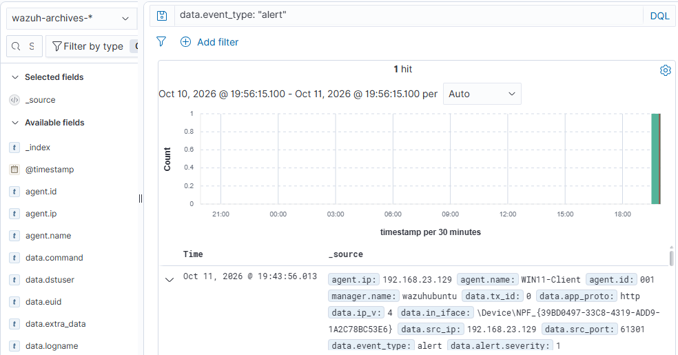
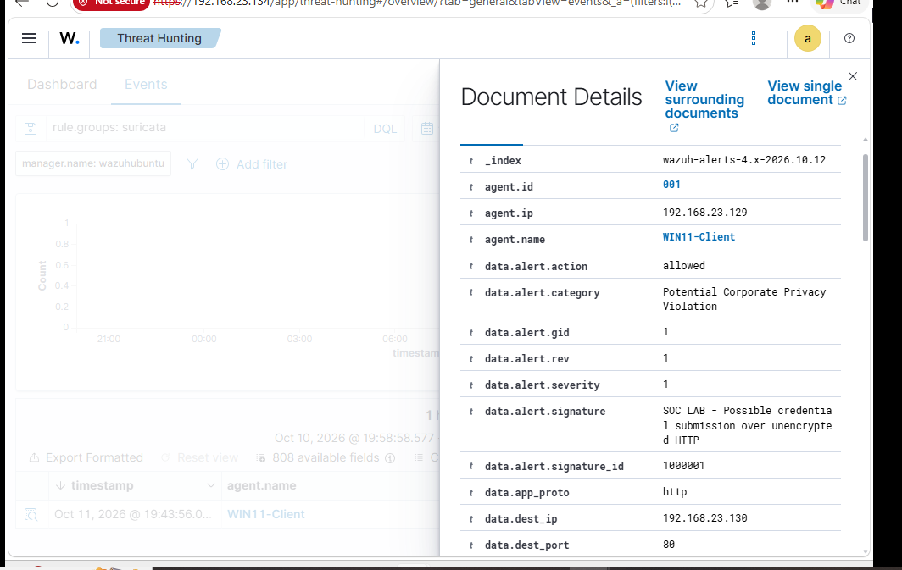
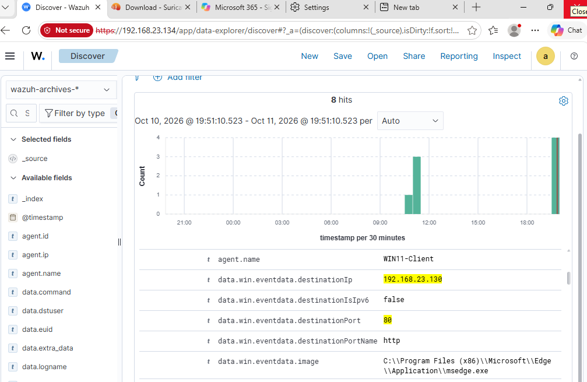

# Suricata Deployment and Wazuh SIEM Integration

## Overview

This document describes the installation, configuration, and validation of Suricata on the Windows 11 endpoint in the Enterprise SOC Lab. The goal was to extend Sysmon's process and network-connection telemetry with application-layer inspection, detect potential credential submissions over unencrypted HTTP, and forward the resulting events to Wazuh.

**Outcome:** A custom Suricata signature detected a controlled HTTP form submission using dummy credentials. The resulting alert was visible in Wazuh Discover and Threat Hunting.

## Lab Environment

| Component | Configuration |
|---|---|
| Hypervisor | VMware Workstation 17 Player |
| Windows endpoint | Windows 11 Pro (`WIN11-Client`) |
| Windows endpoint IP | `192.168.23.129` |
| Attacker VM | Kali Linux (`192.168.23.130`) |
| SIEM | Wazuh on Ubuntu Server 22.04 LTS (`192.168.23.134`) |
| Suricata | Version 8.0.7 |
| Packet capture | Npcap 1.89 |
| Wazuh agent | Version 4.14.8, agent ID `001` |
| Virtual network | VMware NAT |

## Architecture

```text
Windows 11 network traffic
        |
        v
Npcap packet capture
        |
        v
Suricata (HTTP inspection and local.rules)
        |
        v
C:\Program Files\Suricata\log\eve.json
        |
        v
Windows Wazuh Agent
        |
        v
Wazuh Manager / Indexer
        |                |
        v                v
Discover archives   Threat Hunting alerts
```

Suricata was installed on the Windows endpoint to inspect its own traffic without modifying the VMware NAT topology. The current lab deployment uses detection rather than active blocking.

## 1. Install Suricata and Npcap

Install Suricata from the [official download page](https://suricata.io/download/). In this lab, it was installed to:

```text
C:\Program Files\Suricata
```

Install Npcap from the [official download page](https://npcap.com/#download). The lab used these installer settings:

- **Restrict Npcap driver's access to Administrators only:** unchecked
- **Support raw 802.11 traffic:** unchecked (the VM uses Ethernet)
- **Install Npcap in WinPcap API-compatible Mode:** checked

Verify that `suricata.exe` and `suricata.yaml` are present in the Suricata installation directory.

## 2. Identify the Active Network Adapter (Portable Instructions)

**Do not reuse the GUID from this lab on another machine.** Windows adapter names and GUIDs differ between systems.

Open **PowerShell as Administrator inside the Windows VM** and list active adapters:

```powershell
Get-NetAdapter | Where-Object Status -eq 'Up' | Select-Object Name, InterfaceDescription, InterfaceGuid
```

Identify the adapter carrying the lab traffic. In this deployment, the active interface was named `Ethernet0`, but your adapter may have a different name.

Display its GUID, substituting your own adapter name if necessary:

```powershell
(Get-NetAdapter -Name 'Ethernet0').InterfaceGuid
```

### Start Suricata without manually copying the GUID

Once you have identified the correct adapter name, use the following **portable** PowerShell commands. The GUID is obtained automatically from the local machine:

```powershell
cd 'C:\Program Files\Suricata'
$guid = (Get-NetAdapter -Name 'Ethernet0').InterfaceGuid
.\suricata.exe -c suricata.yaml -S rules\local.rules -i "\Device\NPF_$guid"
```

Change `Ethernet0` if your adapter has another name. The `\Device\NPF_` prefix is required for the Npcap capture device. Start Suricata only after creating and validating the custom rule in the following sections.

### Actual adapter details from this lab

For reproducibility, the original endpoint used:

```text
Adapter name: Ethernet0
Description: Intel(R) 82574L Gigabit Network Connection
GUID: {39BD0497-33C8-4319-ADD9-1A2C78BC53E6}
Npcap device: \Device\NPF_{39BD0497-33C8-4319-ADD9-1A2C78BC53E6}
```

**These are recorded observations, not universal values.** Readers should determine their own adapter and GUID using the commands above.

## 3. Create the HTTP Credential-Submission Detection Rule

Create the rules directory, if it does not already exist:

```powershell
New-Item -ItemType Directory -Force 'C:\Program Files\Suricata\rules'
```

Open the custom rules file in Administrator Notepad:

```powershell
notepad 'C:\Program Files\Suricata\rules\local.rules'
```

Insert this rule **on one line**:

```suricata
alert http any any -> any any (msg:"SOC LAB - Possible credential submission over unencrypted HTTP"; flow:established,to_server; http.method; content:"POST"; http.request_body; content:"password="; nocase; classtype:policy-violation; sid:1000001; rev:1;)
```

The rule matches HTTP traffic that uses `POST` and includes the literal `password=` pattern in the request body. It does not require the destination IP address to be known in advance.

| Rule element | Purpose |
|---|---|
| `alert http` | Alert on matching HTTP traffic |
| `flow:established,to_server` | Examine traffic sent toward the server |
| `http.method; content:"POST"` | Match HTTP POST requests |
| `http.request_body; content:"password="` | Match the tested request-body pattern |
| `nocase` | Case-insensitive match |
| `sid:1000001` | Lab-specific signature ID |

The rule is a heuristic for **possible** insecure credential transmission. It does not establish that genuine credentials were stolen, and it does not inspect encrypted HTTPS request bodies.

## 4. Validate and Run Suricata

From Administrator PowerShell:

```powershell
cd 'C:\Program Files\Suricata'
.\suricata.exe -T -c suricata.yaml -S rules\local.rules
```

The configuration test returned:

```text
Configuration provided was successfully loaded. Exiting.
```

For live monitoring, use the dynamic adapter commands from Section 2:

```powershell
$guid = (Get-NetAdapter -Name 'Ethernet0').InterfaceGuid
.\suricata.exe -c suricata.yaml -S rules\local.rules -i "\Device\NPF_$guid"
```

The engine successfully reported:

```text
Engine started.
```

**Current deployment limitation:** Suricata was launched interactively from PowerShell for testing. Automatic background startup has **not** yet been configured.

## 5. Suricata Logs

Suricata produced logs under:

```text
C:\Program Files\Suricata\log
```

| File | Role |
|---|---|
| `eve.json` | JSON telemetry, flow records, statistics, and alert events |
| `fast.log` | Text-format alerts, when produced |

Initial testing confirmed network packet capture and JSON statistics. Some early network-flow records did not show recognized HTTP activity; the successful later submission did generate an HTTP alert.

## 6. Forward Suricata Events to Wazuh

On the Windows endpoint, edit the existing Wazuh agent configuration as Administrator:

```text
C:\Program Files (x86)\ossec-agent\ossec.conf
```

Within the existing `<ossec_config>` block, add:

```xml
<localfile>
  <location>C:\Program Files\Suricata\log\eve.json</location>
  <log_format>json</log_format>
</localfile>
```

Retain the existing Sysmon collection block:

```xml
<localfile>
  <location>Microsoft-Windows-Sysmon/Operational</location>
  <log_format>eventchannel</log_format>
</localfile>
```

Save the file and restart the Windows Wazuh agent:

```powershell
Restart-Service WazuhSvc
```

The agent forwards collected events to the Wazuh Manager. The lab already had `logall_json` enabled and Filebeat archive forwarding configured on Ubuntu, and a `wazuh-archives-*` index pattern created in the dashboard.

## 7. Verify Raw Events in Wazuh Discover

In the Wazuh web dashboard, open **Explore → Discover** and select:

```text
wazuh-archives-*
```

Search for Suricata statistics events:

```text
data.event_type: "stats"
```

During verification, 29 matching statistics events were visible. This established that the Suricata → Wazuh agent → Wazuh Manager → indexed archive pipeline worked.

Suricata flow records were also accessible using:

```text
data.dest_port: 80
```

## 8. Verify the Credential-Submission Detection

A controlled phishing simulation used an HTTP form hosted at `http://192.168.23.130/phishing.html`. The Windows endpoint opened the page and submitted **dummy credentials** to the lab handler at `/login.php`.

The successfully generated Suricata alert included:

| Field | Observed value |
|---|---|
| `data.event_type` | `alert` |
| `data.alert.signature` | `SOC LAB - Possible credential submission over unencrypted HTTP` |
| `data.alert.signature_id` | `1000001` |
| `data.alert.severity` | `1` (Suricata scale) |
| `data.app_proto` | `http` |
| `data.dest_ip` | `192.168.23.130` |
| `data.dest_port` | `80` |
| `data.alert.action` | `allowed` |

### Evidence — Detection in Discover



The same detection appeared in **Threat Hunting → Events**, confirming that Wazuh generated an alert rather than merely archiving the event.

### Evidence — Threat Hunting Alert



The generated Wazuh alert used:

```text
rule.id: 86601
rule.level: 3
```

Wazuh rule level 3 is distinct from Suricata's severity 1. A targeted Wazuh severity increase is planned but **has not yet been applied**.

### Evidence — Earlier Sysmon Network Visibility

Before Suricata was added, Sysmon Event ID 3 showed Microsoft Edge connecting to Kali on TCP port 80:



This confirmed network-connection telemetry but did not, by itself, indicate credential submission.

## 9. Troubleshooting and Lessons Learned

| Issue | Observation and resolution |
|---|---|
| Unsupported `--list-interfaces` option | Identified the active adapter with Windows `Get-NetAdapter` instead |
| Wrong executable path | Changed directory to `C:\Program Files\Suricata` and used relative commands |
| Typo `NPD` instead of `NPF` | Corrected the Npcap device prefix |
| Missing default rule files | Tested and ran Suricata using only the lab's `local.rules` file with `-S` |
| Missing `threshold.config` | Warning was nonfatal during successful validation and capture |
| Initial flow events without HTTP alert | A subsequent controlled browser test generated the expected HTTP detection |
| Archived event vs. security alert | Verified both Discover (`wazuh-archives-*`) and Threat Hunting (`wazuh-alerts-*`) |

## 10. Results

| Milestone | Status |
|---|---|
| Suricata and Npcap installed | Complete |
| Live endpoint packet capture | Verified |
| Custom HTTP rule syntax | Validated |
| Suricata JSON event logging | Verified |
| Wazuh JSON log collection | Verified |
| Archived Suricata events in Discover | Verified |
| Simulated HTTP credential submission detected | Verified |
| Wazuh Threat Hunting alert | Verified, rule `86601`, level 3 |
| High-priority Wazuh custom rule | Pending |
| Automatic background Suricata startup | Pending |
| Broader maintained ruleset and tuning | Pending |

## 11. Limitations and Next Steps

- The custom signature matches a specific HTTP request-body pattern; it is not comprehensive phishing detection.
- A match indicates **possible credential submission over unencrypted HTTP**, not proof that the destination is malicious or that a real account was compromised.
- The lab used dummy credentials only; do not publish real credentials or collected password values.
- HTTPS request bodies are encrypted and cannot be inspected through this rule without additional authorized decryption infrastructure.
- Suricata currently detects and logs the traffic but does not block it.
- The capture interface must be selected per system; the documented GUID is specific to this VM.
- Raw archive indexing can increase disk consumption and needs suitable retention settings.

Planned improvements:

1. Create a targeted Wazuh rule to elevate signature `1000001` from Wazuh level 3 to level 10, then retest.
2. Configure Suricata to start automatically in the background.
3. Evaluate false positives and other credential-form formats.
4. Add and tune a maintained Suricata ruleset where appropriate.
5. Correlate Suricata alerts with Sysmon Event IDs 1 and 3 for a fuller attack timeline.

## Conclusion

The Enterprise SOC Lab now correlates endpoint telemetry with an application-layer network detection. The controlled HTTP login-form submission triggered Suricata signature `1000001`, reached Wazuh, and appeared as a security alert in Threat Hunting. The portable installation instructions above separate this lab's recorded network-adapter identity from the steps other users should follow on their own systems.
